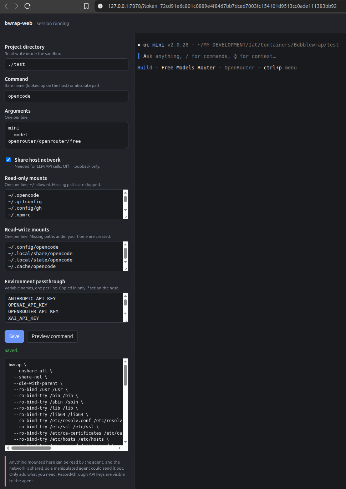

# bwrap-web

A small local web app that launches a coding agent (OpenCode by default) inside a [bubblewrap](https://github.com/containers/bubblewrap) sandbox and gives you a browser terminal plus a settings panel for the sandbox.



You choose a project directory, which extra paths to mount, whether to keep the network, and which environment variables to pass through. `bwrap-web` builds the `bwrap` command from those settings and runs it in a terminal on the page.

It is a single Rust binary with one HTML file embedded in it.

## Features

- Edit the project directory, command, arguments, network access, read-only mounts, read-write mounts and environment passthrough from a web page.
- Settings are validated and saved to `~/.config/bwrap-web/config.json`.
- **Preview command** shows the exact `bwrap` command line. Passed-through API keys are masked in the preview.
- **Reset to defaults** refills the form with the built-in defaults; nothing is written until you press **Save**.
- A full interactive terminal in the browser (xterm.js over a websocket and a PTY), including resize.
- Relative project paths such as `./test` are supported.
- Closing the page or pressing **Stop** ends the sandbox.

## Requirements

- Linux with unprivileged user namespaces enabled
- `bubblewrap` (`bwrap`) installed
- A recent stable Rust toolchain to build (1.85 or newer; Ubuntu's packaged 1.75 is too old for current crate releases). Install with [rustup](https://rustup.rs) if needed.
- A browser with internet access: the terminal library (xterm.js) is loaded from the jsDelivr CDN, pinned to `xterm@5.3.0` and `xterm-addon-fit@0.8.0`
- The agent you want to run (for example `opencode`) installed on the host

## Install and build

```bash
# Debian/Ubuntu: sudo apt install bubblewrap
# Fedora:        sudo dnf install bubblewrap
# Arch:          sudo pacman -S bubblewrap

cargo build --release
```

The binary is `target/release/bwrap-web`. You can copy it anywhere, for example `~/.local/bin/`.

## Usage

Start the server from the directory that contains your project (or its parent):

```bash
cd ~/work
bwrap-web                 # listens on 127.0.0.1:7878
bwrap-web --port 9000     # choose another port
```

It prints a URL containing a one-time token:

```
bwrap-web is running. Open this URL in your browser:
  http://127.0.0.1:7878/?token=<64 hex characters>
```

Open that URL, adjust the settings on the left, press **Save**, then **Start session**.

The token changes every time the server starts. Stop the server with Ctrl-C.

## Settings

| Setting                     | Meaning                                                      |
| --------------------------- | ------------------------------------------------------------ |
| **Project directory**       | The only directory the agent can write to (besides the read-write mounts). Absolute, `~/...`, or relative (see below). |
| **Command**                 | Program to run in the sandbox. A bare name is looked up on the host (`PATH`, then `~/.opencode/bin`, then `~/.local/bin`); or give an absolute path. |
| **Arguments**               | Arguments for the program, **one per line**.                 |
| **Share host network**      | On: the sandbox uses the host network (needed for LLM APIs and `localhost` services). Off: loopback only. |
| **Read-only mounts**        | Extra paths visible read-only, one per line. `~/` is expanded. Paths that don't exist are skipped. |
| **Read-write mounts**       | Extra paths visible read-write, one per line. Missing paths under your home directory are created so agent state persists. |
| **Environment passthrough** | Names of host environment variables to copy into the sandbox, if they are set. Everything else is cleared. |

### Relative project paths

`./test`, `test` and `../other` are resolved against the directory where `bwrap-web` was **started**, then canonicalized (symlinks and `..` resolved) before any safety check runs. A saved `./test` therefore points at a different folder if you start the server from a different directory. Use an absolute path or `~/...` for a fixed project.

### Arguments: one per line using OpenCode as an example

These examples use flags verified against OpenCode v2.0.28. Check the [official CLI docs](https://opencode.ai/docs/cli/) for the latest flags.

Each line becomes exactly one argument. A flag and its value go on separate lines, and no quoting is needed:

```
mini
--model
openrouter/openrouter/free
```

This opens the TUI with the chosen model.

A line like `-m openrouter/openrouter/free` would be passed as a single argument containing a space, which most programs reject. Leave the field empty for a normal interactive session. Check your agent's `--help` for the flags it supports.

**Continue your last session:**

```
-c
```

**Choose a model and continue the last session:**

```
mini
--model
anthropic/claude-sonnet-4-5
-c
```

This continues the last session in the TUI with the chosen model.

**One-shot task, no interactive TUI:**

```
run
fix the failing tests
```

A message with spaces is fine on one line, because it's a single argument. The quoting is handled for you, so don't add quotes.

**One-shot task with JSON output (for scripting):**

```
run
--format
json
explain this codebase
```

**Auto-approve permissions (no prompts):**

```
run
--auto
fix the failing tests
```

**Fork the last session (keep the original intact):**

```
--fork
-c
```

**Get JSON output instead of formatted text:**

```
run
--format
json
explain this codebase
```

**Resume a specific session:**

```
-s
ses_abc123
```

**Run its web server instead of the TUI:**

```
web
--port
4096
--hostname
127.0.0.1
```

Because the network is shared, the server is reachable from the host, and `--hostname 127.0.0.1` keeps it from listening on your LAN. The terminal in bwrap-web won’t be useful for this mode, since you’d open the printed URL in a browser.

### Default mounts and variables

Out of the box the sandbox gets:

- Read-only: `/usr`, `/bin`, `/sbin`, `/lib`, `/lib64`, a few files under `/etc` (DNS, certificates, users), plus `~/.opencode`, `~/.gitconfig`, `~/.config/gh`, `~/.npmrc`, `~/.local/bin`, `~/.nvm`, `~/.local/share/fnm`, `~/.npm-global`, `~/.bun`, `~/.cargo`, `~/.rustup` (each only if it exists)
- Read-write: the project directory, `~/.config/opencode`, `~/.local/share/opencode`, `~/.local/state/opencode`, `~/.cache/opencode`
- Private empty `/tmp`, `/var/tmp`, `/run`; fresh `/dev` and `/proc`; separate PID, IPC, UTS and user namespaces
- Environment passthrough for common API keys (`ANTHROPIC_API_KEY`, `OPENAI_API_KEY`, `OPENROUTER_API_KEY`, `XAI_API_KEY`, `GOOGLE_API_KEY`, `GEMINI_API_KEY`, `GOOGLE_GENERATIVE_AI_API_KEY`, `GROQ_API_KEY`, `DEEPSEEK_API_KEY`, `MISTRAL_API_KEY`, `ZAI_API_KEY`) and `OPENCODE_CONFIG`
- Also set inside: `HOME`, `USER`, `PATH`, `TERM`, `COLORTERM`, `LANG`

Everything else in your home directory (including `~/.ssh`) is invisible. To allow git over SSH, add `~/.ssh` to the read-only mounts, and read the security notes first.

The program you run must live inside a mounted path. If it doesn't, `bwrap-web` tells you which directory to add.

## Security model

This server can launch programs, so treat it like a shell.

- It listens on `127.0.0.1` only.
- Every request needs the per-run random token (compared in constant time).
- The `Host` header must be `127.0.0.1:<port>` or `localhost:<port>`, which blocks DNS-rebinding attacks.
- If an `Origin` header is present it must be the same origin, which blocks cross-site websocket hijacking.
- `bwrap` is started with an explicit argument list, never through a shell, so paths and arguments can't inject commands.
- Mounting `/` or your home directory (or any parent of it) is refused, including through a symlink. Read-write mounts of system directories (`/usr`, `/etc`, `/bin`, `/dev`, ...) are refused. `..` is not allowed in mount paths.
- The token is in the URL, so it appears in your browser history. Don't share the URL or paste it into screenshots.

### What the sandbox does not protect against

- **Data leaving over the network.** With network sharing on, anything the agent can read (project files, its own credentials, passed-through API keys, anything you mounted) could be sent out if the agent is manipulated, for example by prompt injection from a file or web page. Mount only what you need.
- **Git hooks.** The project directory is writable, including `.git/hooks`. Hooks run outside the sandbox when you later use git, so review them if you let the agent work unattended.
- **Kernel exploits.** Namespaces share the host kernel. For hostile or untrusted code use a microVM.
- **No seccomp or Landlock.** The sandbox uses namespaces, dropped capabilities and `NO_NEW_PRIVS` only.
- **Any local process can use the port**, but only with the token. Multi-user machines deserve extra care.

## Project layout

```
bwrap-web/
├── Cargo.toml
├── src/main.rs          server, config, validation, bwrap command builder, PTY websocket
└── static/index.html    the web page (embedded into the binary at build time)
```

### HTTP endpoints

| Endpoint              | Purpose                                                      |
| --------------------- | ------------------------------------------------------------ |
| `GET /`               | The web page                                                 |
| `GET /api/config`     | Current settings (JSON)                                      |
| `PUT /api/config`     | Validate and save settings                                   |
| `GET /api/config/defaults` | Built-in default settings (nothing is saved)            |
| `GET /api/preview`    | The `bwrap` command line for the saved settings              |
| `GET /ws?cols=&rows=` | Websocket terminal. Binary frames are keyboard input and output; a text frame `{"cols":N,"rows":M}` resizes |

All endpoints require the token, as an `x-token` header or a `token=` query parameter.

## Troubleshooting

| Symptom                                                      | Cause and fix                                                |
| ------------------------------------------------------------ | ------------------------------------------------------------ |
| `bwrap: No permissions to create new namespace` or `setting up uid map: Permission denied` | Unprivileged user namespaces are blocked. On Ubuntu 23.10 and later, AppArmor restricts them by default; allow `bwrap` through an AppArmor profile or relax `kernel.apparmor_restrict_unprivileged_userns`. |
| `starting bwrap (is bubblewrap installed?)`                  | Install `bubblewrap` and make sure `bwrap` is in `PATH`.     |
| `'opencode' was not found in PATH`                           | Install the agent, or put an absolute path in **Command**.   |
| `... is not inside any mounted path`                         | Add the directory containing the program to **Read-only mounts**. |
| `project directory ... does not exist`                       | Check the path. Relative paths are resolved from where `bwrap-web` was started. |
| `... is your home directory or one of its parents`           | Intentional. Point the project at a subdirectory.            |
| `missing or invalid token` or a WebSocket error              | Use the full URL printed at startup. The token changes on every restart. |
| `bad host`                                                   | Open the page through `127.0.0.1:<port>` or `localhost:<port>`, not another hostname or a proxy. |
| Terminal area stays blank                                    | The browser couldn't load xterm.js from the CDN. Check internet access and content blockers. |
| `Address already in use`                                     | Another process uses the port; pass `--port`.                |
| A tool inside the sandbox is "not found"                     | Its directory isn't mounted. Add it to **Read-only mounts**. |

## Uninstall

```bash
rm ~/.local/bin/bwrap-web            # or wherever you put the binary
rm -r ~/.config/bwrap-web            # saved settings
```

## Limitations

- Linux only (it relies on bubblewrap and user namespaces).
- One shared configuration; each browser connection starts its own separate sandbox session.
- The settings page covers the options listed above only. Anything else needs a code change in `build_args` in `src/main.rs`.